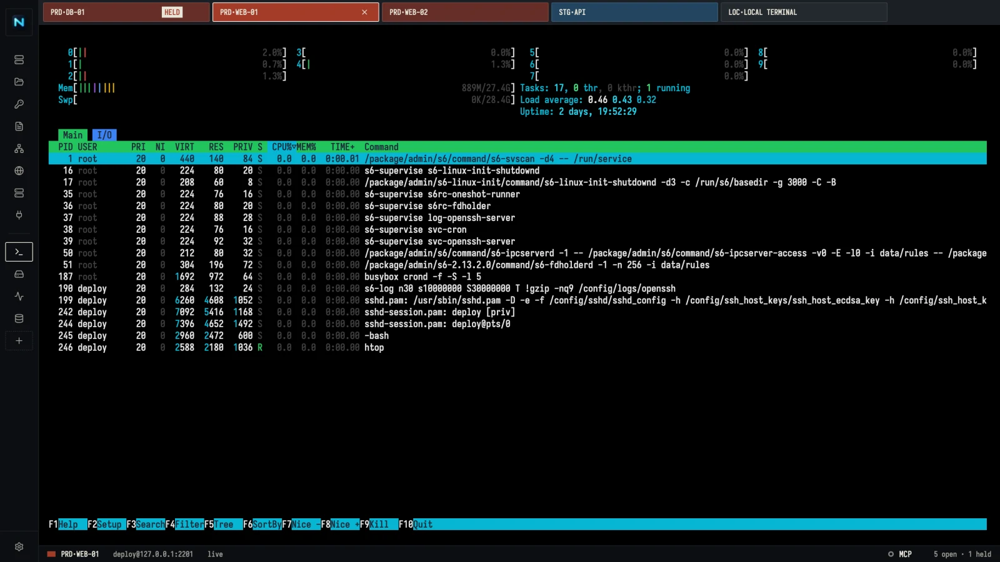
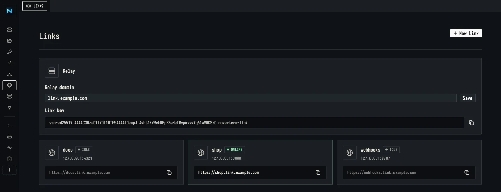

<div align="center">

# Noverterm

**SSH for you and your AI.**

An open-source Termius alternative built for the AI era: SSH, an MCP server and ngrok-style Links in one app, so you and your agent go from server to public URL without leaving it. For macOS, Windows, and Linux.

[](https://github.com/noverwork/noverterm/releases)
[]()
[](LICENSE)

[Download](https://github.com/noverwork/noverterm/releases) · [Website](https://noverwork.github.io/noverterm/) · [Report a bug](https://github.com/noverwork/noverterm/issues)

</div>



Your AI agent works your servers through the built-in MCP server: Claude Code, Cursor and others run commands, edit files and open tunnels on your hosts, each step approved by you. Links put what you build on a public HTTPS URL through a relay you run yourself, like a self-hosted ngrok. Around them sits a full SSH client: tabs, SFTP, port forwarding, jump hosts, keys and snippets. All data stays in a local SQLite database. No account, no cloud sync.

## Highlights

- **MCP server for AI agents** — Claude Code, Cursor, VS Code, and Claude Desktop can run commands, edit files, open tunnels, publish Links, and read terminal tabs on your hosts, with your approval
- **Links** — share a dev server or receive webhooks at `https://<name>.<your-domain>`, ngrok-style, through your own relay
- **One workflow** — your agent edits code on a host, starts the dev server, and publishes it with a Link, all in one app
- **Tabs for everything** — many SSH sessions, plus a local terminal, side by side
- **TUI-ready** — Kitty keyboard protocol, IME input, and paste handling for vim, tmux, and htop
- **Dual-pane SFTP** — local or any saved host on each side, drag and drop between them
- **Local-first** — connections, keys, and snippets never leave your machine

## Features

### Terminal

- Multiple SSH sessions in tabs; duplicate a session or open a local terminal instantly
- Password and SSH key authentication
- Host fingerprint verification and a known hosts manager
- Dropped connections reconnect when you switch back to the tab
- Immediate output on idle sessions, bounded binary streaming, ordered input with visible write failures
- Negotiated Kitty keyboard protocol with modifier, repeat, and release events
- In-terminal search

### AI assistant

1. Open **Settings → AI assistant**. Pick a provider (Anthropic, OpenCode Go, or any OpenAI-compatible API such as OpenAI or Ollama), enter the model and API key, and click **Save**.
2. In a terminal tab, press `Cmd+K` (`Ctrl+Shift+K` on Windows and Linux) and describe what you want. The assistant turns it into a command.
3. To explain output, select it first, then press `Cmd+K`.

### SFTP file transfer

- Dual-pane browser: local or any host in each pane
- Drag and drop, multi-select, recursive folder transfer
- Transfer progress and conflict resolution
- Create, rename, and delete files and folders

### Port forwarding

- Local SSH tunnels saved as presets
- Several ports per preset

### Links



- Publish a local HTTP service at `https://<name>.<your-domain>`, the way ngrok does, without a third-party service
- Runs through a relay on your own server: one Docker image plus a domain and its wildcard; see [packages/relay](packages/relay/README.md)
- Only keys you add to the relay can connect; each install shows its own Link key to copy
- HTTPS and WebSockets; reconnects by itself when the line drops
- Plain `ssh -R <name>:80:localhost:3000` works against the same relay

### Snippets

- Save frequent commands and run them in active sessions
- Pin snippets to the sidebar as one-click launchers with a custom icon

### Connections and keys

- Organize connections into groups; each group paints its tabs in its own colour with a stencilled code, such as `PRD·WEB-01`
- Reach private servers through jump hosts (like `ssh -J`), chained up to five hops; terminal, SFTP, and port forwarding all tunnel through them
- Import and manage SSH keys

### MCP server for AI agents

- Turn on the built-in MCP server, then paste the ready-made command into Claude Code, Cursor, VS Code, or Claude Desktop
- Tools:
  - Commands: `list_hosts`, `run_command`, and `run_command_multi` to run one command on several hosts at once
  - Long-running and interactive commands: `start_command`, then `read_command`, `write_command` (stdin), and `stop_command`
  - Files: `list_dir`, `read_file`, and `write_file` for text files; `upload_file` and `download_file` copy files and folders over SFTP
  - Snippets: `list_snippets` and `run_snippet`
  - Port forwarding: `list_port_forwards`, `start_port_forward` (listens on 127.0.0.1), and `stop_port_forward` for tunnels the agent opened
  - Links: `list_links`, `start_link` to publish a local web service at a public URL through your own relay, and `stop_link`
  - Terminal tabs: `list_terminals` and `read_terminal` return a tab's recent output as plain text
- Everything that touches a host or a terminal tab needs your approval, including input sent to a running command: allow once, always allow a host (saved with the host, change it in its settings), or deny; a request nobody answers is denied after one minute
- Publishing a Link always asks, every time: there is no "always allow" for putting a service online
- Listens on 127.0.0.1 only, behind a token kept in the local database
- Passwords and keys stay in Noverterm; the agent sees host names, never credentials
- Hosts must pass their fingerprint check, and jump hosts work as they do in the terminal

### App

- Built-in updater from GitHub Releases
- Dark theme, keyboard shortcuts, context menus

## Download

| Platform | Package |
|----------|---------|
| macOS (Apple Silicon) | `.dmg` |
| Windows | `.exe` installer |
| Linux (x86-64) | `.AppImage` or `.deb` |

Get the latest version from [Releases](https://github.com/noverwork/noverterm/releases). Noverterm checks for updates on its own after install.

On macOS, install from the terminal (builds are not notarized, so this avoids the Gatekeeper prompt):

```bash
curl -fsSL https://raw.githubusercontent.com/noverwork/noverterm/main/install.sh | sh
```

If you install the `.dmg` instead, macOS blocks the first launch. Open **System Settings → Privacy & Security** and click **Open Anyway**, or run `xattr -dr com.apple.quarantine /Applications/noverterm.app`.

## Quick Start

1. Open Noverterm and click **New connection**.
2. Enter the host, port, and user. Choose password or SSH key authentication.
3. Connect. On first connect, verify the host fingerprint.
4. Open more sessions in tabs, or open a **Local Terminal**.
5. Use the sidebar for SFTP, port forwards, SSH keys, and snippets.

### Connect through a jump host

1. Save the bastion as a normal connection.
2. Create a connection for the private server. Enter its address as the bastion sees it, such as `10.0.1.5`.
3. Under **Jump host**, select the bastion and save.

Connecting asks you to verify the bastion's fingerprint first, then the target's. Each host signs in with its own saved credentials, and your private keys stay on your machine. To chain more hops, give the bastion a jump host of its own. The bastion's SSH server must allow TCP forwarding (`AllowTcpForwarding yes`, the OpenSSH default).

## Keyboard Shortcuts

On Windows and Linux, use `Ctrl` in place of `Cmd`.

| Action | Shortcut |
|--------|----------|
| AI assistant | `Cmd+K` (`Ctrl+Shift+K` on Windows and Linux) |
| Settings | `Cmd+,` |
| Jump to tab 1–9 | `Cmd+1` … `Cmd+9` |
| Next / previous tab | `Cmd+Shift+]` / `Cmd+Shift+[`, `Ctrl+Tab` / `Ctrl+Shift+Tab` |
| Search in terminal | `Cmd+F` |
| Next / previous match (macOS) | `Cmd+G` / `Cmd+Shift+G` |
| Copy selection | `Cmd+C` (only with a selection, else sent to the shell) |
| Paste | `Cmd+V`, `Ctrl+Shift+V`, `Shift+Insert` |
| Close tab (macOS) | `Cmd+W` |

## Data and Privacy

- All data is stored in a local SQLite database in the app data folder.
- No account, telemetry, or cloud sync.
- The only network traffic besides your SSH connections, your own relay (if you use Links) and your AI provider (if you use the assistant) is the update check against GitHub Releases.
- **Settings → Data** backs the database up to your Downloads folder and restores it from a backup file.

## Build from Source

Prerequisites: Rust stable, [cargo-make](https://github.com/sagiegurari/cargo-make).

```bash
cargo make bundle
```

The bundled app is in `target/release/bundle/`.

### Development

```bash
cargo make dev                # run the app
cargo make screenshots        # render every page offscreen to target/screenshots
cargo make ci                 # clippy, format check, tests
scripts/site-shots.sh         # re-shoot the website screenshots (needs Docker and cwebp)
```

### Tech stack

| Layer | Technology |
|-------|------------|
| UI | GPUI with GPUI Kit components |
| Terminal | alacritty_terminal |
| SSH | Russh (pure Rust) |
| Async runtime | Tokio |
| Database | SQLite + Diesel |

### Project structure

```
noverterm/
├── packages/
│   ├── desktop/        # The app: GPUI front end and SSH backend, owns the SQLite database
│   ├── relay/          # Self-hosted relay for Links (noverterm-relay, Docker image)
│   ├── shared/         # Record types shared by the backend and the UI
│   └── orm/            # Diesel models and schema
├── Cargo.toml          # Rust workspace
└── Makefile.toml       # cargo-make tasks
```

## Contributing

Contributions are welcome. Fork it, hack on it, and send a pull request.

- **Bug reports and ideas:** open an [issue](https://github.com/noverwork/noverterm/issues).
- **Pull requests:** welcome. Run `cargo make ci` before you open one.
- **Security issues:** [report privately](https://github.com/noverwork/noverterm/security/advisories/new). Do not open a public issue.

## License

Noverterm is released under the [MIT License](LICENSE).

## Acknowledgements

- [GPUI](https://www.gpui.rs/) and [GPUI Kit](https://gpui-kit.com) — UI framework and components
- [alacritty_terminal](https://github.com/alacritty/alacritty) — terminal emulation
- [Russh](https://github.com/Eugeny/russh) — pure Rust SSH implementation

---

<div align="center">

**Noverterm** — SSH for you and your AI.

</div>
